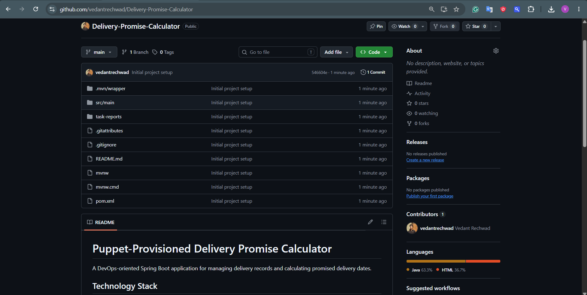

# Delivery Promise Calculator — Task 2: Agile Planning and DevOps Workflow
**Student Name:** Vedant Rechwad  
**Roll No.:** 23102A0054  
**Project:** Delivery Promise Calculator (PromiseFlow)  
**Academic Year:** 2026 | DevOps Engineering Lab

---

### 1. Objective
Apply Agile Scrum methodology to plan, prioritize, and structure the iterative development of the Delivery Promise Calculator, mapping out sprints, user stories, acceptance criteria, and DevOps toolchain integration.

---

### 2. Agile Methodology & Sprint Plan
The project was executed across four distinct 2-week sprints:

```
[ Sprint 1: Core Foundation ] ──> [ Sprint 2: UI & RBAC Auth ] ──> [ Sprint 3: Automated Testing ] ──> [ Sprint 4: CI/CD & Deploy ]
  • Spring Boot 4 + Java 21         • Glassmorphic UI Design           • JUnit 5 Mockito Suites           • Jenkinsfile Pipeline
  • SQLite Relational DB             • Thymeleaf Templates              • Selenium E2E Suite               • Docker Containerization
  • Base SLA Promise Engine          • Role-Based Access Control        • Headless Chrome in CI            • Puppet Config Mgmt
```

#### Sprint Breakdown:
1. **Sprint 1 (Architecture & Core SLA Engine):** Establish Spring Boot skeleton, SQLite database schema, JPA entities, and core arithmetic transit calculation algorithms.
2. **Sprint 2 (Glassmorphic UI & Role-Based Access Control):** Implement modern glassmorphic interface, session management, multi-role auth (`ADMIN`, `OPERATIONS`, `CUSTOMER`), and click-to-autofill demo credential capabilities.
3. **Sprint 3 (Comprehensive Testing & Quality Assurance):** Implement unit test suite (13 tests) and end-to-end Selenium WebDriver tests (3 tests) supporting headless execution.
4. **Sprint 4 (Continuous Integration, Containerization & Reliability):** Script Jenkins declarative pipeline, package Docker image on Alpine JRE, and implement Puppet manifest for automated drift remediation.

---

### 3. Epics and User Stories

| ID | Epic | User Story | Acceptance Criteria |
| :--- | :--- | :--- | :--- |
| **US-01** | Core SLA | As a logistics coordinator, I want promised delivery dates calculated from shipping speed tiers and transit days. | Given transit days and speed tier (`EXPRESS`, `STANDARD`, `SAME_DAY`), calculate non-past promised date. |
| **US-02** | RBAC Auth | As an evaluator/user, I want role-based authentication with click-to-autofill so I can switch personas smoothly. | Clicking empty username/password inputs populates valid demo credentials for Admin, Ops, or Customer. |
| **US-03** | Operations | As an Operations Lead, I want to update shipment statuses across warehouse milestones. | Operations users can advance orders from PENDING -> PROCESSING -> SHIPPED -> DELIVERED. |
| **US-04** | Tracking | As a retail customer, I want to look up parcel progress using a tracking ID. | Entering `TRK-IN-XXXX` renders a visual 4-milestone journey stepper with current status highlighted. |
| **US-05** | DevOps CI | As a DevOps engineer, I want automated regression testing on every push. | Jenkins triggers build, runs 13 unit tests and 3 Selenium tests, failing on any regression. |
| **US-06** | Deploy | As a release engineer, I want the application packaged into an immutable Docker container. | `docker build` produces a runnable container serving traffic on port 8766. |

---

### 4. DevOps Toolchain Architecture

```
[Developer IDE] ──> [Git / GitHub] ──> [Jenkins CI Server] ──> [Quality Gates] ──> [Docker Packaging] ──> [Puppet CM]
  • VS Code           • main branch       • Pipeline-as-Code       • Unit Tests (13)   • eclipse-temurin:21    • delivery_promise.pp
  • Java 21           • feature branches  • Windows Master         • Selenium UI (3)   • Port 8766             • Drift Recovery
```

---

### 5. Actual Project Screenshots & Technical Evidence

#### Figure 1. Agile Sprint Workflow & Repository Baseline

*Figure 1: GitHub repository baseline used for Agile sprint branch planning, issue tracking, and version-controlled sprint releases.*

#### Figure 2. Real-Time Logistics Operations Board with Multi-Role Management

*Figure 2: The delivered operations board showing sprint deliverables: active shipments, SLA compliance metrics (92.3%), demo presets, and role switching.*\n