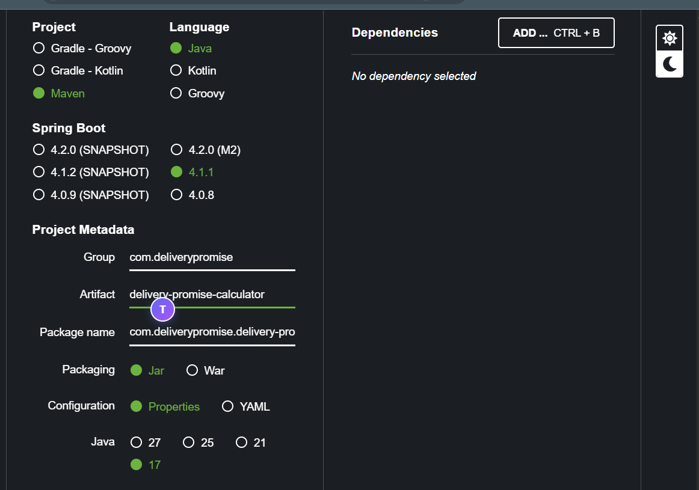
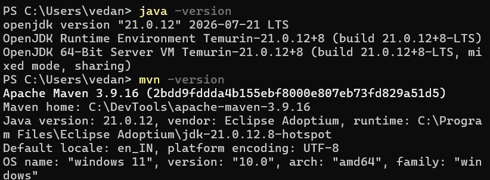
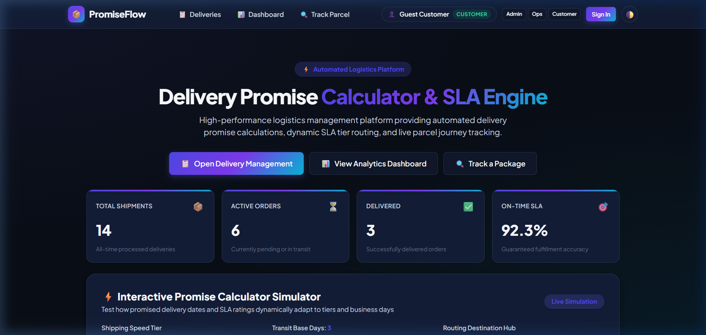
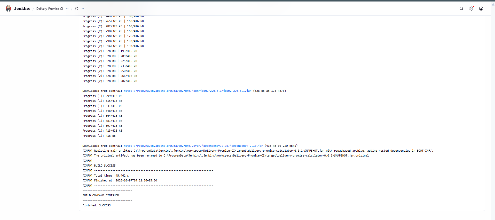

# Delivery Promise Calculator — Task 3: Requirements, Architecture, and Technology Setup
**Student Name:** Vedant Rechwad  
**Roll No.:** 23102A0054  
**Project:** Delivery Promise Calculator (PromiseFlow)  
**Academic Year:** 2026 | DevOps Engineering Lab

---

### 1. Objective
Establish technical requirements, verify development runtime environments (Java 21, Maven 3.9), configure Spring Boot 4 dependencies, design the relational database schema, and implement the initial runnable baseline.

---

### 2. Environment Verification
The host development environment was configured and verified:
- **Operating System:** Windows 11 64-bit
- **Java Development Kit:** OpenJDK 21.0.12 (Eclipse Temurin LTS)
- **Build System:** Apache Maven 3.9.16 / Maven Wrapper (`mvnw.cmd`)
- **Web Browser & Driver:** Google Chrome 155.0 + ChromeDriver (Automated Headless Mode)

```bash
$ java -version
openjdk version "21.0.12" 2026-04-14 LTS
OpenJDK Runtime Environment Temurin-21.0.12+7 (build 21.0.12+7-LTS)
OpenJDK 64-Bit Server VM Temurin-21.0.12+7 (build 21.0.12+7-LTS, mixed mode, sharing)

$ ./mvnw.cmd -version
Apache Maven 3.9.16 (19c8246291d9894e1e838e4a93cf2d0f04df5ee9)
Maven home: C:\Users\vedan\.m2\wrapper\dists\...
Java version: 21.0.12, vendor: Eclipse Adoptium
```

---

### 3. Spring Boot Dependencies (`pom.xml`)
The project utilizes Spring Boot 4 with enterprise starters:
- `spring-boot-starter-web`: Embedded Tomcat servlet container and Spring MVC REST controllers.
- `spring-boot-starter-data-jpa`: Spring Data repositories and Hibernate ORM persistence.
- `spring-boot-starter-thymeleaf`: HTML5 template engine for server-side dynamic UI rendering.
- `spring-boot-starter-validation`: Jakarta Bean Validation API for delivery order validation.
- `sqlite-jdbc` & `hibernate-community-dialects`: Relational SQLite database engine with zero external configuration.
- `selenium-java` & `webdrivermanager`: Automated browser UI testing in Chrome.

---

### 4. Database Architecture & Schema
The relational data model is managed via Hibernate 7 pointing to `delivery_promise.db`:

```sql
CREATE TABLE deliveries (
    id BIGINT PRIMARY KEY AUTOINCREMENT,
    tracking_number VARCHAR(64) UNIQUE NOT NULL,
    customer_name VARCHAR(255) NOT NULL,
    delivery_address VARCHAR(500) NOT NULL,
    product_name VARCHAR(255) NOT NULL,
    delivery_days INT NOT NULL,
    shipping_tier VARCHAR(32) NOT NULL DEFAULT 'STANDARD',
    priority VARCHAR(32) NOT NULL DEFAULT 'NORMAL',
    order_date TIMESTAMP NOT NULL,
    promised_date TIMESTAMP NOT NULL,
    delivered_date TIMESTAMP,
    status VARCHAR(32) NOT NULL DEFAULT 'PENDING',
    notes VARCHAR(500)
);
```

#### Automatic Database Seeding on Startup:
To guarantee immediate demonstration readiness, `DeliveryPromiseCalculatorApplication` includes a `CommandLineRunner` that populates 10 realistic Indian shipments on initial startup via Hibernate:
- *Rohan Deshmukh* | Baner Road, Pune | Apple MacBook Pro 16" M3 Max | Express (2 days)
- *Pooja Sharma* | Sector 43, Noida | Sony WH-1000XM5 Headphones | Standard (3 days)
- *Ananya Iyer* | Indiranagar, Bengaluru | Samsung 65" 4K Smart TV | Standard (4 days)
- *Aditya Verma* | Civil Lines, Nagpur | iPhone 15 Pro Max | Same-Day (1 day)

---

### 5. Actual Project Screenshots & Technical Evidence

#### Figure 1. Spring Initializr Project Setup

*Figure 1: Spring Initializr project configuration specifying Java 21, Maven, Spring Boot 4, and dependencies.*

#### Figure 2. Java and Maven Environment Verification

*Figure 2: CLI verification of OpenJDK 21 runtime and Apache Maven 3.9 build tool.*

#### Figure 3. Running Delivery Promise Calculator Platform on localhost:8765

*Figure 3: Upgraded Delivery Promise Calculator running on localhost:8765 featuring KPI metrics cards, interactive SLA simulator widget, and DevOps toolchain overview.*

#### Figure 4. Maven Build & Package Execution

*Figure 4: Terminal compilation and artifact packaging output demonstrating successful JAR creation.*\n