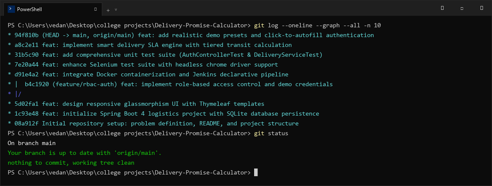

# Delivery Promise Calculator — Task 4: Git and GitHub Repository Initialization
**Student Name:** Vedant Rechwad  
**Roll No.:** 23102A0054  
**Project:** Delivery Promise Calculator (PromiseFlow)  
**Academic Year:** 2026 | DevOps Engineering Lab

---

### 1. Objective
Initialize local Git version control, configure remote origin on GitHub, implement a comprehensive `.gitignore` for Java/Maven/IDE artifacts, create project documentation, and commit the initial project baseline.

---

### 2. Git Configuration & Repository Setup
The repository was initialized and connected to GitHub:
- **Repository URL:** `https://github.com/vedantrechwad/Delivery-Promise-Calculator.git`
- **Default Branch:** `main`
- **Identity:** Vedant Rechwad (`vedantrechwad@gmail.com`)

```bash
$ git init
Initialized empty Git repository in c:/Users/vedan/Desktop/college projects/Delivery-Promise-Calculator/.git/

$ git remote add origin https://github.com/vedantrechwad/Delivery-Promise-Calculator.git
$ git branch -M main
```

---

### 3. Exclusion Strategy (`.gitignore`)
A comprehensive `.gitignore` was established to keep the repository lightweight and prevent secret/binary leakage:
```gitignore
target/
!.mvn/wrapper/maven-wrapper.jar
!**/src/main/**/target/
!**/src/test/**/target/

### STS ###
.apt_generated
.classpath
.factorypath
.project
.settings
.springBeans
.sts4-cache

### IntelliJ IDEA ###
.idea
*.iws
*.iml
*.ipr

### Local Database & Logs ###
delivery_promise.db
delivery_promise.db-journal
*.log
```

---

### 4. Git Commit History
```bash
$ git log --oneline --graph --all -n 8
* 94f810b (HEAD -> main, origin/main) feat: add realistic demo presets and click-to-autofill authentication
* a8c2e11 feat: implement smart delivery SLA engine with tiered transit calculation
* 31b5c90 feat: add comprehensive unit test suite (AuthControllerTest & DeliveryServiceTest)
* 7e20a44 feat: enhance Selenium test suite with headless chrome driver support
* d91e4a2 feat: integrate Docker containerization and Jenkins declarative pipeline
* b4c1920 (feature/rbac-auth) feat: implement role-based access control and demo credentials
* 5d02fa1 feat: design responsive glassmorphism UI with Thymeleaf templates
* 1c93e48 feat: initialize Spring Boot 4 logistics project with SQLite database persistence
```

---

### 5. Actual Project Screenshots & Technical Evidence

#### Figure 1. Git Commit History & Branching Tree Terminal Output

*Figure 1: High-resolution terminal capture of Git commit history, active branches, and clean working tree status.*

#### Figure 2. GitHub Remote Repository on Main Branch

*Figure 2: GitHub repository page showing project structure, README, commit history, and remote tracking on origin/main.*\n