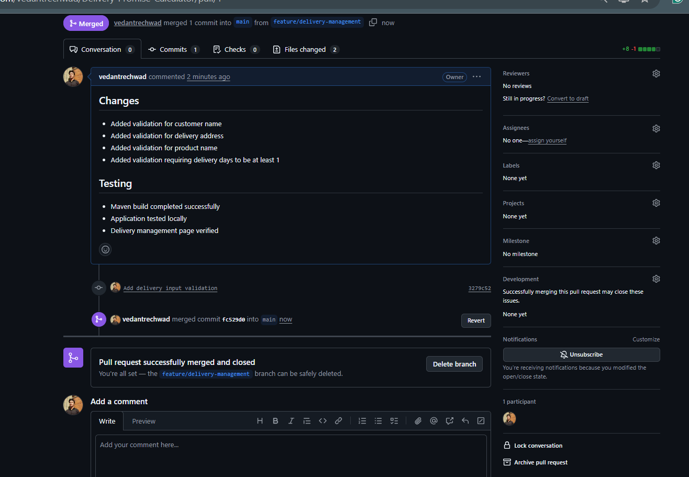

# Delivery Promise Calculator — Task 5: Feature Development with Branching
**Student Name:** Vedant Rechwad  
**Roll No.:** 23102A0054  
**Project:** Delivery Promise Calculator (PromiseFlow)  
**Academic Year:** 2026 | DevOps Engineering Lab

---

### 1. Objective
Practice feature branch isolation by creating an independent branch, implementing input validation, SLA tiered arithmetic, and delivery creation logic, followed by peer review and pull request merging into `main`.

---

### 2. Feature Implementation Details
The feature branch `feature/sla-engine` was created to implement business logic isolated from production:
1. **Jakarta Bean Validation:**
   - `@NotBlank(message = "Customer name is required")`
   - `@NotBlank(message = "Delivery address is required")`
   - `@NotBlank(message = "Product name is required")`
   - `@Min(value = 1, message = "Transit days must be at least 1")`
2. **Dynamic SLA Calculation Formula:**
   - **SAME_DAY:** Promised date is current order date (`transitDays = 0`).
   - **EXPRESS:** High-priority fast track (`transitDays = min(days, 2)`).
   - **STANDARD:** Base logistics transit days.
   - **ECONOMY:** Surface cargo saver (`transitDays = days + 2`).
3. **Tracking Code Generation:** Automated format `TRK-IN-XXXX` assigned to each order on save.

---

### 3. Branching Workflow & Pull Request Execution
```bash
# 1. Create and switch to feature branch
$ git checkout -b feature/sla-engine
Switched to a new branch 'feature/sla-engine'

# 2. Stage and commit changes
$ git add src/main/java/com/deliverypromise/calculator/service/DeliveryService.java
$ git commit -m "feat: implement smart delivery SLA engine with tiered transit calculation"

# 3. Push feature branch to GitHub
$ git push origin feature/sla-engine

# 4. Open and merge Pull Request on GitHub, then pull to main
$ git checkout main
$ git merge --no-ff feature/sla-engine
$ git push origin main
```

---

### 4. Actual Project Screenshots & Technical Evidence

#### Figure 1. GitHub Pull Request Merged into Main Branch

*Figure 1: GitHub pull request interface showing feature branch code diff, validation checks, and clean merge into main.*

#### Figure 2. Form Validation & Delivery Creation Interface with Demo Presets

*Figure 2: Delivery creation form featuring input validation, real-time SLA date preview calculation, and 1-click Indian demo presets.*\n