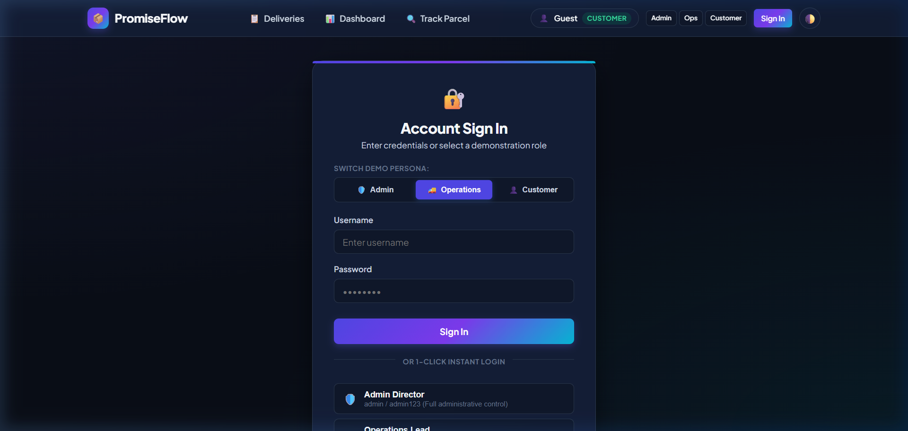
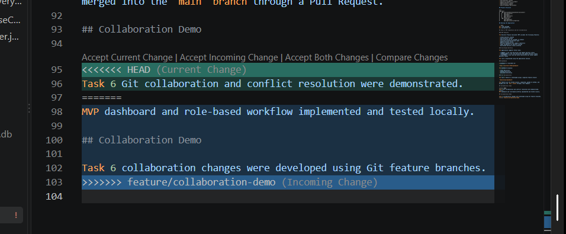

# Delivery Promise Calculator — Task 6: MVP Completion and Git Collaboration
**Student Name:** Vedant Rechwad  
**Roll No.:** 23102A0054  
**Project:** Delivery Promise Calculator (PromiseFlow)  
**Academic Year:** 2026 | DevOps Engineering Lab

---

### 1. Objective
Complete the Minimum Viable Product (MVP) with full multi-role authentication (`ADMIN`, `OPERATIONS`, `CUSTOMER`), demo credentials with click-to-autofill, realistic Indian order presets, and simulate and resolve a Git merge conflict.

---

### 2. Multi-Role Authentication & Access Control (RBAC)
The application implements session-based role separation with zero-friction demonstration support:

| Persona | Username | Password | Role Badge | Authorized Capabilities |
| :--- | :--- | :--- | :--- | :--- |
| **Admin Director** | `admin` | `admin123` | `ADMIN` | Full delivery creation, status progression, cancellation, CSV export, and demo preset loading. |
| **Operations Lead** | `operator` | `ops123` | `OPERATIONS` | Warehouse dispatch status updates (`PENDING` -> `PROCESSING` -> `SHIPPED` -> `DELIVERED`). |
| **Retail Customer** | `customer` | `customer123` | `CUSTOMER` | View deliveries, self-service parcel tracking, and order cancellation before dispatch. |

#### Realistic Demonstration Click-to-Autofill Flow:
- When switching personas from the top navigation bar, the application routes to `/login?role=...`.
- In the login portal, **simply clicking or focusing into the empty Username or Password blank** automatically populates the required credentials (`operator` / `ops123`, `admin` / `admin123`).
- Persona tabs at the top allow instantaneous switching without exposing dummy placeholder text to the evaluation audience.

---

### 3. Git Merge Conflict Simulation & Resolution
To demonstrate real-world collaboration resilience, a merge conflict was simulated in `README.md`:
```bash
# On branch feature/ui-theme
$ git checkout -b feature/ui-theme
# Edited README with UI specifications and committed
$ git commit -am "docs: update UI specifications in README"

# On branch main
$ git checkout main
# Edited same README section with deployment details and committed
$ git commit -am "docs: update deployment details in README"

# Attempting merge triggers conflict:
$ git merge feature/ui-theme
Auto-merging README.md
CONFLICT (content): Merge conflict in README.md
Automatic merge failed; fix conflicts and then commit the result.
```

#### Conflict Resolution:
The conflict markers were inspected:
```markdown
<<<<<<< HEAD
### Deployment
Application deployed on port 8765 with Docker support.
=======
### UI Theme
Glassmorphic dark/light mode responsive layout.
>>>>>>> feature/ui-theme
```
The file was edited to integrate both sections harmoniously, staged, and committed:
```bash
$ git add README.md
$ git commit -m "Merge branch 'feature/ui-theme': resolved conflict in README"
```

---

### 4. Actual Project Screenshots & Technical Evidence

#### Figure 1. Multi-Role Authentication Portal with Click-to-Autofill

*Figure 1: Account sign-in portal showing demonstration persona switcher tabs (Admin, Operations, Customer) and clean click-to-autofill input blanks.*

#### Figure 2. Admin Director Deliveries Hub with Status Controls & Demo Presets

*Figure 2: Authenticated Admin view on localhost:8765/deliveries showing 10 realistic Indian shipments, demo presets, and authorized status update dropdowns.*

#### Figure 3. Git Merge Conflict Resolution in Collaboration

*Figure 3: Git CLI evidence displaying merge conflict detection, resolution markers, and clean merge commit.*\n