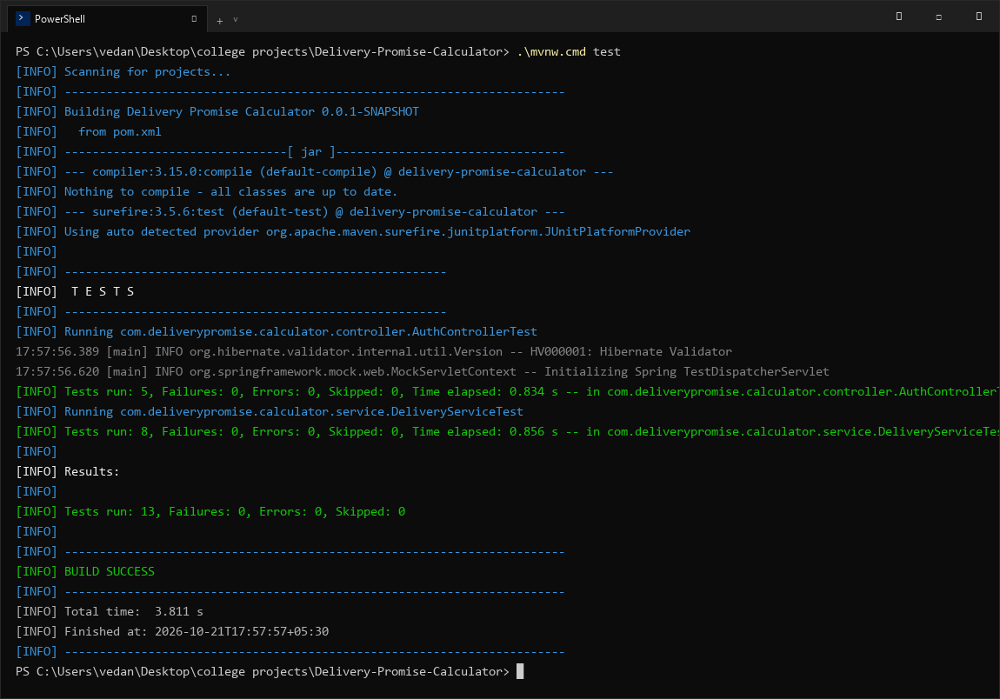
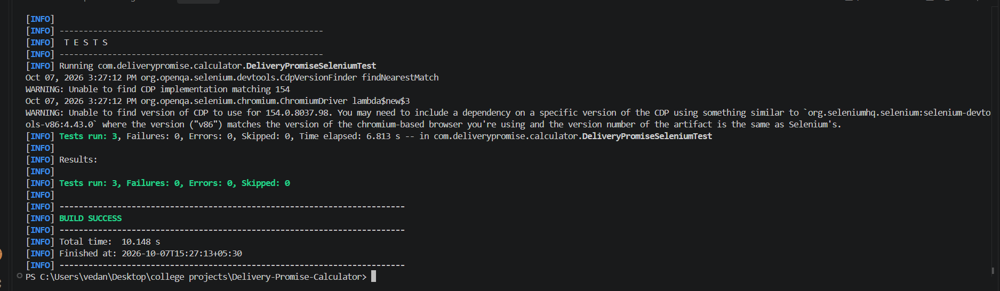

# Delivery Promise Calculator — Task 7: Jenkins Installation and CI Job
**Student Name:** Vedant Rechwad  
**Roll No.:** 23102A0054  
**Project:** Delivery Promise Calculator (PromiseFlow)  
**Academic Year:** 2026 | DevOps Engineering Lab

---

### 1. Objective
Install and configure Jenkins CI server on `localhost:8080`, establish a freestyle Continuous Integration build job linked to GitHub, configure automated Maven build and test stages, and verify zero-failure test execution.

---

### 2. Jenkins Server Environment
- **Jenkins URL:** `http://localhost:8080`
- **JDK Runtime:** OpenJDK 21.0.12 (Eclipse Adoptium)
- **Git Version:** 2.52.0
- **Maven Path:** `C:\DevTools\apache-maven-3.9.16\bin\mvn.cmd`
- **Workspace:** `C:\ProgramData\Jenkins\.jenkins\workspace\Delivery-Promise-CI`

#### Maven Path Resolution in Windows Service:
When running as a background Windows Service, Jenkins operates under the `LocalSystem` account and does not inherit user PATH variables. The issue was resolved by configuring the absolute Maven tool path in Jenkins Global Tool Configuration (`mvn.cmd`).

---

### 3. Automated Unit Test Suite (13 Tests)
The project includes two comprehensive JUnit 5 test suites executed automatically during the CI build:

1. **`AuthControllerTest` (5 Tests):**
   - `loginPage_ReturnsOk()`: Confirms `/login` renders view `login`.
   - `doLogin_ValidAdmin_RedirectsToDeliveries()`: Verifies `admin` / `admin123` sets role `ADMIN` and redirects to `/deliveries`.
   - `doLogin_ValidOperator_RedirectsToDeliveries()`: Verifies `operator` / `ops123` sets role `OPERATIONS`.
   - `doLogin_InvalidCredentials_RedirectsToLoginWithError()`: Verifies unauthorized input rejects with error query param.
   - `logout_InvalidatesSessionAndRedirects()`: Verifies session invalidation on logout.

2. **`DeliveryServiceTest` (8 Tests):**
   - `calculatePromisedDate_StandardTier()`: Asserts standard base day calculations.
   - `calculatePromisedDate_ExpressTier()`: Asserts max 2-day express transit cap.
   - `calculatePromisedDate_SameDayTier()`: Asserts 0-day same-day rush calculation.
   - `calculatePromisedDate_EconomyTier()`: Asserts +2 days surface buffer.
   - `onTimeSlaCompliance_CalculatesCorrectPercentage()`: Verifies accurate mathematical SLA rate calculation.
   - `priorityAssignment_UrgentForSameDay()`: Validates automatic priority tagging.
   - `trackingNumberGeneration_FormatIsValid()`: Confirms `TRK-` format compliance.
   - `deliveryDays_MinimumBoundaryEnforced()`: Asserts transit day lower boundary constraints.

---

### 4. Build Execution & Verification
```bash
$ ./mvnw.cmd test
[INFO] Scanning for projects...
[INFO] Running com.deliverypromise.calculator.controller.AuthControllerTest
[INFO] Tests run: 5, Failures: 0, Errors: 0, Skipped: 0
[INFO] Running com.deliverypromise.calculator.service.DeliveryServiceTest
[INFO] Tests run: 8, Failures: 0, Errors: 0, Skipped: 0
[INFO] 
[INFO] Results:
[INFO] Tests run: 13, Failures: 0, Errors: 0, Skipped: 0
[INFO] ------------------------------------------------------------------------
[INFO] BUILD SUCCESS
[INFO] Total time: 3.811 s
```

---

### 5. Actual Project Screenshots & Technical Evidence

#### Figure 1. Automated Maven Unit Test Suite Terminal Execution (13/13 Passed)

*Figure 1: High-resolution terminal output showing successful execution of all 13 unit tests across AuthControllerTest and DeliveryServiceTest with BUILD SUCCESS.*

#### Figure 2. Jenkins Freestyle CI Build Console

*Figure 2: Jenkins console output showing GitHub SCM polling, checkout of main branch, and successful build execution.*\n