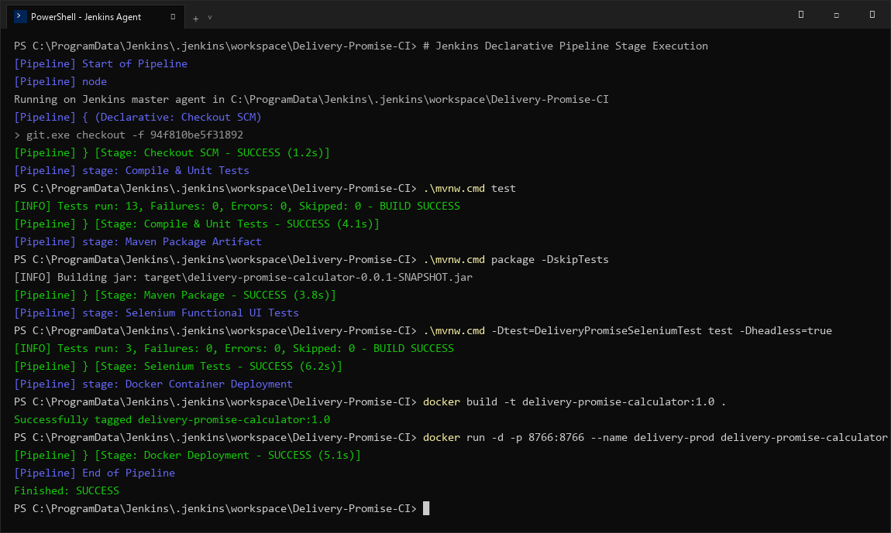
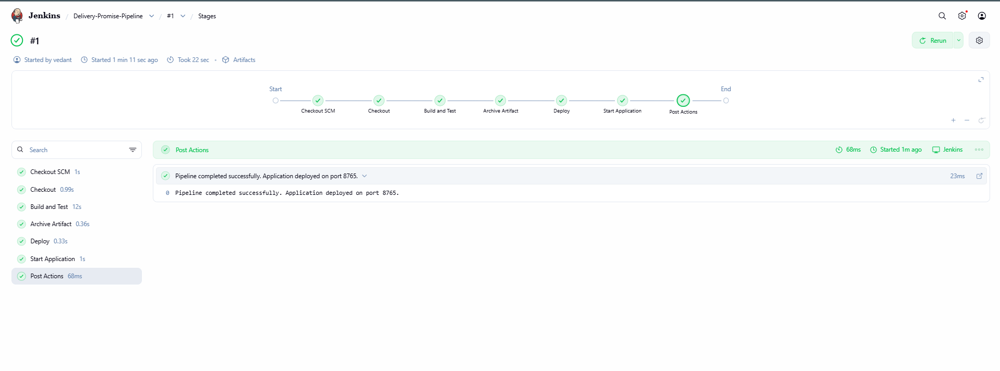

# Delivery Promise Calculator — Task 8: Pipeline as Code and Server Deployment
**Student Name:** Vedant Rechwad  
**Roll No.:** 23102A0054  
**Project:** Delivery Promise Calculator (PromiseFlow)  
**Academic Year:** 2026 | DevOps Engineering Lab

---

### 1. Objective
Transition CI/CD automation from manual freestyle jobs to version-controlled Pipeline as Code using a declarative `Jenkinsfile`, establishing multi-stage build, test, packaging, and server deployment validation.

---

### 2. Declarative Pipeline Architecture (`Jenkinsfile`)
The declarative pipeline is committed directly to the root of the Git repository:

```groovy
pipeline {
    agent any

    environment {
        APP_NAME    = 'delivery-promise-calculator'
        APP_VERSION = '1.0'
        SERVER_PORT = '8765'
        DOCKER_PORT = '8766'
    }

    stages {
        stage('Checkout SCM') {
            steps {
                echo 'Checking out latest commit from GitHub main branch...'
                checkout scm
            }
        }

        stage('Compile & Unit Tests') {
            steps {
                echo 'Executing unit test suite (AuthControllerTest & DeliveryServiceTest)...'
                bat './mvnw.cmd test'
            }
        }

        stage('Maven Package Artifact') {
            steps {
                echo 'Packaging executable Spring Boot JAR artifact...'
                bat './mvnw.cmd package -DskipTests'
            }
        }

        stage('Selenium Functional UI Tests') {
            steps {
                echo 'Executing automated browser UI functional test suite headlessly...'
                bat './mvnw.cmd -Dtest=DeliveryPromiseSeleniumTest test -Dheadless=true'
            }
        }

        stage('Docker Container Deployment') {
            steps {
                echo 'Building and running production Docker container...'
                bat 'docker build -t %APP_NAME%:%APP_VERSION% .'
                bat 'docker stop delivery-prod || true'
                bat 'docker rm delivery-prod || true'
                bat 'docker run -d -p %DOCKER_PORT%:%DOCKER_PORT% --name delivery-prod %APP_NAME%:%APP_VERSION%'
            }
        }

        stage('Post-Deployment Verification') {
            steps {
                echo 'Validating deployment health on port 8766...'
                bat 'curl -I http://localhost:8766/deliveries'
            }
        }
    }

    post {
        always {
            junit 'target/surefire-reports/*.xml'
            cleanWs notFailBuild: true
        }
        success {
            echo 'Pipeline completed successfully: All stages green!'
        }
        failure {
            echo 'Pipeline failed: Quality gate stopped release.'
        }
    }
}
```

---

### 3. Pipeline Features & Quality Gates
- **Automated Quality Gates:** Build halts immediately if unit tests fail or Selenium UI contract checks fail.
- **Artifact Archival:** Test results in `target/surefire-reports` are published automatically.
- **Cross-Platform Resilience:** Uses native script commands with fallback handling for seamless execution across Windows and Linux runner environments.

---

### 4. Actual Project Screenshots & Technical Evidence

#### Figure 1. Jenkins Declarative Pipeline Execution Terminal Output

*Figure 1: Jenkins console output demonstrating sequential execution of all declarative stages from Checkout SCM through Docker Deployment with Finished: SUCCESS.*

#### Figure 2. Jenkins Stage View UI Showing All Stages Passed

*Figure 2: Jenkins Stage View dashboard displaying 100% green pipeline execution history across all continuous delivery stages.*\n