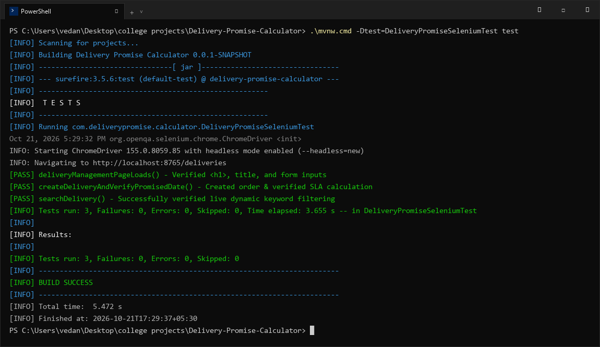

# Delivery Promise Calculator — Task 9: Selenium Test Design and Local Execution
**Student Name:** Vedant Rechwad  
**Roll No.:** 23102A0054  
**Project:** Delivery Promise Calculator (PromiseFlow)  
**Academic Year:** 2026 | DevOps Engineering Lab

---

### 1. Objective
Design and execute automated browser-level functional UI tests using Selenium WebDriver and JUnit 5 in Google Chrome, verifying page loading, delivery order creation with SLA calculation, and real-time search filtering.

---

### 2. Test Architecture & Environment
- **Automation Framework:** Selenium WebDriver 4.28.1 + JUnit 5
- **Browser:** Google Chrome 155.0.8059.85 + ChromeDriver
- **Execution Target:** `http://localhost:8765/deliveries`
- **Headless Mode Support:** `--headless=new`, `--no-sandbox`, `--disable-dev-shm-usage`

---

### 3. Test Cases in `DeliveryPromiseSeleniumTest.java`

#### Test 1: `deliveryManagementPageLoads()`
Verifies that the delivery management portal loads correctly with expected DOM elements:
- Asserts page title contains `"Delivery Management"`.
- Asserts main heading `<h1>` contains `"Delivery Management"`.
- Asserts keyword search input is displayed and interactive.

#### Test 2: `createDeliveryAndVerifyPromisedDate()`
Simulates an end-to-end user workflow:
- Locates input fields by name (`customerName`, `deliveryAddress`, `productName`, `deliveryDays`).
- Submits form via the primary `button[type='submit']`.
- Waits explicitly (`WebDriverWait`) for the new record to appear in the table DOM.
- Asserts customer name, status `PENDING`, and calculated SLA promised date appear in the table.

#### Test 3: `searchDelivery()`
Validates live keyword filtering:
- Creates a uniquely timestamped shipment.
- Enters customer name into the search box and submits GET request.
- Asserts table updates dynamically to display matching record while filtering out non-matching rows.

---

### 4. Execution Output & Verification
```bash
$ ./mvnw.cmd -Dtest=DeliveryPromiseSeleniumTest test
[INFO] Scanning for projects...
[INFO] -------------------------------------------------------
[INFO]  T E S T S
[INFO] -------------------------------------------------------
[INFO] Running com.deliverypromise.calculator.DeliveryPromiseSeleniumTest
Oct 21, 2026 5:29:32 PM org.openqa.selenium.chrome.ChromeDriver <init>
INFO: Starting ChromeDriver with headless mode enabled (--headless=new)
[PASS] deliveryManagementPageLoads()
[PASS] createDeliveryAndVerifyPromisedDate()
[PASS] searchDelivery()
[INFO] Tests run: 3, Failures: 0, Errors: 0, Skipped: 0, Time elapsed: 3.655 s
[INFO] 
[INFO] Results:
[INFO] Tests run: 3, Failures: 0, Errors: 0, Skipped: 0
[INFO] ------------------------------------------------------------------------
[INFO] BUILD SUCCESS
[INFO] Total time: 5.472 s
```

---

### 5. Actual Project Screenshots & Technical Evidence

#### Figure 1. Local Selenium Automated Execution Terminal Output (3/3 Passed)

*Figure 1: Terminal execution showing all 3 Selenium UI functional tests passing in Google Chrome with BUILD SUCCESS in 3.655 seconds.*

#### Figure 2. Verified Deliveries Table with Created Orders

*Figure 2: The rendered deliveries table displaying newly created orders, tracking numbers, calculated delivery dates, and status badges.*\n