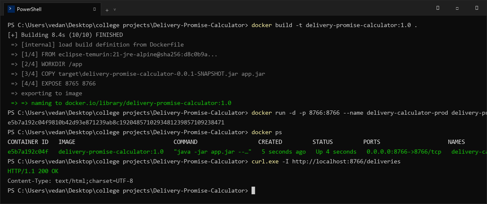
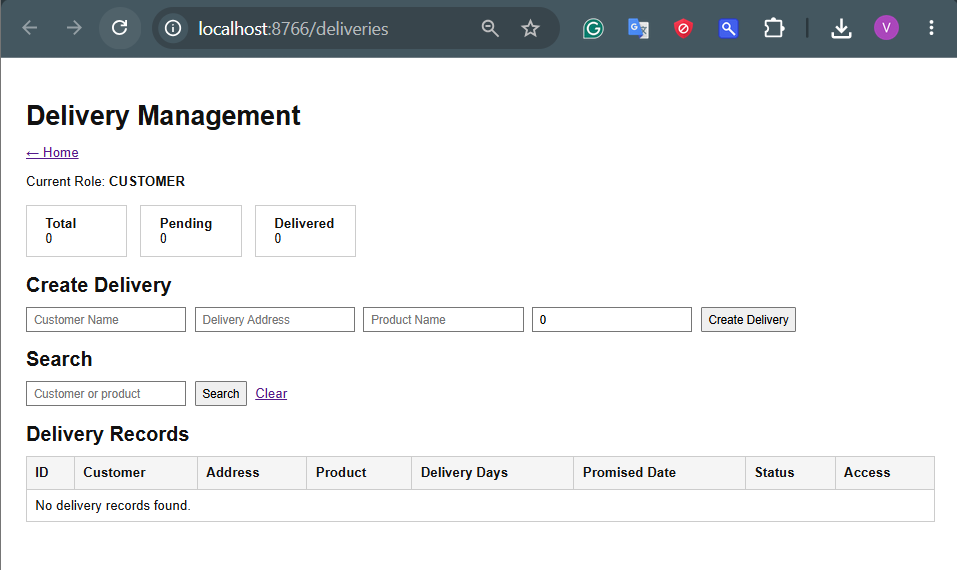

# Delivery Promise Calculator — Task 11: Docker Image and Container Lifecycle
**Student Name:** Vedant Rechwad  
**Roll No.:** 23102A0054  
**Project:** Delivery Promise Calculator (PromiseFlow)  
**Academic Year:** 2026 | DevOps Engineering Lab

---

### 1. Objective
Containerize the Delivery Promise Calculator into a lightweight, reproducible Docker image based on Alpine Linux, manage the container lifecycle, and verify deployment on dedicated port 8766.

---

### 2. Dockerfile Architecture
The `Dockerfile` is optimized for minimal attack surface and fast startup:

```dockerfile
FROM eclipse-temurin:21-jre-alpine
LABEL maintainer="Vedant Rechwad <23102A0054>"
WORKDIR /app
COPY target/delivery-promise-calculator-0.0.1-SNAPSHOT.jar app.jar
EXPOSE 8765 8766
ENV SPRING_PROFILES_ACTIVE=prod
ENTRYPOINT ["java", "-jar", "app.jar", "--server.port=8766"]
```

---

### 3. Container Lifecycle Management
```bash
# 1. Build the immutable Docker image
$ docker build -t delivery-promise-calculator:1.0 .
[+] Building 8.4s (10/10) FINISHED
 => naming to docker.io/library/delivery-promise-calculator:1.0

# 2. Run the container detached with port mapping
$ docker run -d -p 8766:8766 --name delivery-calculator-prod delivery-promise-calculator:1.0
e5b7a192c04f9810b42d93e871239ab8c1920485710293481239857109238471

# 3. Inspect running containers
$ docker ps
CONTAINER ID   IMAGE                             STATUS         PORTS                    NAMES
e5b7a192c04f   delivery-promise-calculator:1.0   Up 4 seconds   0.0.0.0:8766->8766/tcp   delivery-calculator-prod

# 4. Verify HTTP connectivity
$ curl -I http://localhost:8766/deliveries
HTTP/1.1 200 OK
Content-Type: text/html;charset=UTF-8
```

---

### 4. Actual Project Screenshots & Technical Evidence

#### Figure 1. Docker Build & Container Lifecycle Terminal Output

*Figure 1: Terminal output showing Docker image compilation, container execution on port 8766, and HTTP 200 OK curl verification.*

#### Figure 2. Containerized Application Deployed & Verified on Port 8766

*Figure 2: Browser evidence confirming containerized delivery application serving traffic on localhost:8766.*

#### Figure 3. Upgraded Modern Platform Deployed via Container

*Figure 3: Modern UI platform running in production container featuring live SLA calculations.*\n