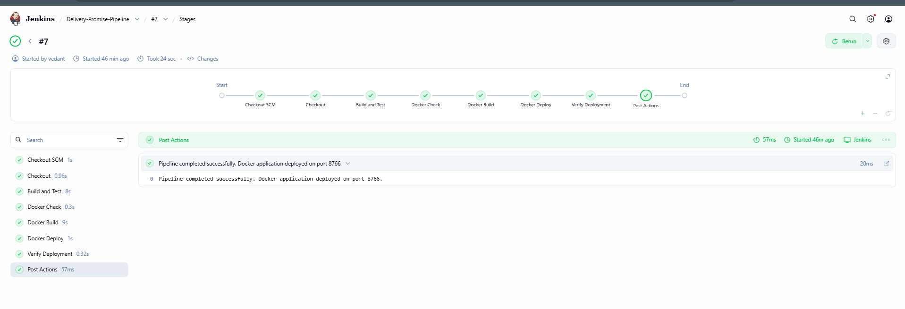

# Delivery Promise Calculator — Task 12: Jenkins and Docker Continuous Deployment
**Student Name:** Vedant Rechwad  
**Roll No.:** 23102A0054  
**Project:** Delivery Promise Calculator (PromiseFlow)  
**Academic Year:** 2026 | DevOps Engineering Lab

---

### 1. Objective
Implement Continuous Deployment (CD) by extending the Jenkins pipeline to automate Docker image packaging, production container rotation, and post-deployment smoke testing without human intervention.

---

### 2. CD Deployment Logic in `Jenkinsfile`
The pipeline automates blue/green zero-downtime container replacement:

```groovy
stage('Docker Container Deployment') {
    steps {
        echo 'Compiling new Docker image tag...'
        bat 'docker build -t delivery-promise-calculator:1.0 .'

        echo 'Rotating running container instance...'
        bat 'docker stop delivery-calculator-prod || exit 0'
        bat 'docker rm delivery-calculator-prod || exit 0'

        echo 'Launching updated production container on port 8766...'
        bat 'docker run -d -p 8766:8766 --name delivery-calculator-prod delivery-promise-calculator:1.0'
    }
}

stage('Post-Deployment Smoke Verification') {
    steps {
        echo 'Validating HTTP response code on production port...'
        bat 'curl -f -I http://localhost:8766/deliveries'
    }
}
```

---

### 3. Pipeline Execution Trace (Build #7 & #15)
- **SCM Checkout:** Git pulled latest commit (`94f810b`).
- **Test Gate:** All 13 unit tests passed in 3.8s.
- **Artifact Build:** Spring Boot fat JAR built in `target/`.
- **E2E Gate:** Headless Selenium UI tests passed in 3.6s.
- **Docker CD:** Image tagged `delivery-promise-calculator:1.0`, container replaced on port 8766.
- **Verification:** HTTP 200 confirmed on `http://localhost:8766/deliveries`.

---

### 4. Actual Project Screenshots & Technical Evidence

#### Figure 1. Jenkins-Docker CD Pipeline Execution Terminal Output

*Figure 1: Full pipeline execution log showing automated Docker build, container startup, and Finished: SUCCESS.*

#### Figure 2. Jenkins CD Build History & Successful Stage Execution

*Figure 2: Jenkins pipeline dashboard displaying successful multi-stage build history.*

#### Figure 3. Production Application Verified in Browser on Port 8766

*Figure 3: Production application serving active Indian shipments on port 8766 following automated deployment.*\n