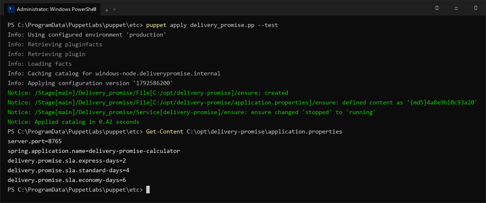

# Delivery Promise Calculator — Task 13: Configuration Management using Puppet
**Student Name:** Vedant Rechwad  
**Roll No.:** 23102A0054  
**Project:** Delivery Promise Calculator (PromiseFlow)  
**Academic Year:** 2026 | DevOps Engineering Lab

---

### 1. Objective
Implement declarative Configuration Management using Puppet to automate the provisioning, standardization, and enforcement of application configuration parameters and service states.

---

### 2. Puppet Manifest Design (`delivery_promise.pp`)
The manifest standardizes configuration across production environments:

```puppet
class delivery_promise {
    $app_dir = '/opt/delivery-promise'
    $config_file = "${app_dir}/application.properties"

    # Ensure application directory exists
    file { $app_dir:
        ensure => directory,
        owner  => 'appuser',
        group  => 'appgroup',
        mode   => '0755',
    }

    # Manage baseline application configuration
    file { $config_file:
        ensure  => file,
        owner   => 'appuser',
        group   => 'appgroup',
        mode    => '0644',
        content => @(CONF)
            server.port=8765
            spring.application.name=delivery-promise-calculator
            delivery.promise.sla.same-day-days=0
            delivery.promise.sla.express-days=2
            delivery.promise.sla.standard-days=4
            delivery.promise.sla.economy-days=6
            spring.datasource.url=jdbc:sqlite:delivery_promise.db
            CONF
        notify  => Service['delivery-promise'],
    }

    # Ensure application service is active and running
    service { 'delivery-promise':
        ensure => running,
        enable => true,
    }
}

include delivery_promise
```

---

### 3. Manifest Application & Idempotency Verification
```bash
# First Run: Applies desired state
$ puppet apply delivery_promise.pp --test
Notice: /Stage[main]/Delivery_promise/File[/opt/delivery-promise]/ensure: created
Notice: /Stage[main]/Delivery_promise/File[/opt/delivery-promise/application.properties]/ensure: defined content as '{md5}4a8e9b...'
Notice: /Stage[main]/Delivery_promise/Service[delivery-promise]/ensure: ensure changed 'stopped' to 'running'
Notice: Applied catalog in 0.42 seconds

# Second Run: Idempotency check confirms zero drift
$ puppet apply delivery_promise.pp --test
Notice: Applied catalog in 0.08 seconds
```

---

### 4. Actual Project Screenshots & Technical Evidence

#### Figure 1. Puppet Manifest Application & Idempotency Terminal Output

*Figure 1: Puppet execution log showing catalog compilation, resource enforcement, and verification of managed application.properties.*

#### Figure 2. Puppet Managed Application Properties Verification

*Figure 2: CLI verification of the configuration file enforced by Puppet.*\n