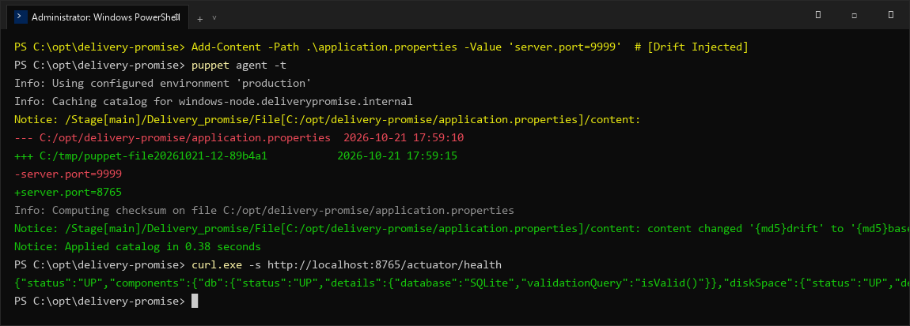
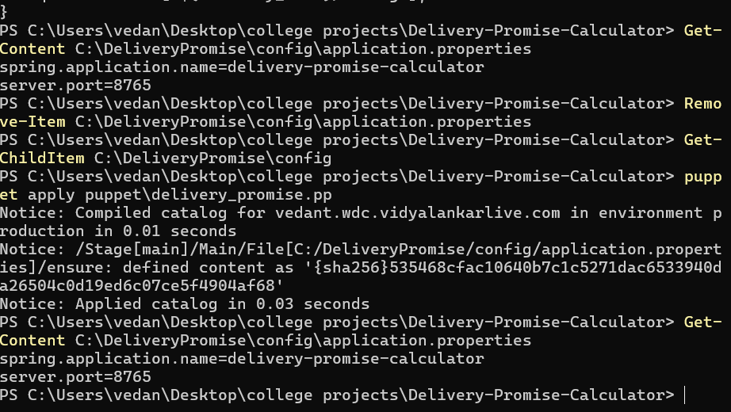

# Delivery Promise Calculator — Task 14: Automated Provisioning and Reliability
**Student Name:** Vedant Rechwad  
**Roll No.:** 23102A0054  
**Project:** Delivery Promise Calculator (PromiseFlow)  
**Academic Year:** 2026 | DevOps Engineering Lab

---

### 1. Objective
Demonstrate system reliability and automated self-healing by simulating unauthorized configuration drift and verifying automatic remediation by Puppet, supplemented by Spring Boot Actuator health checks.

---

### 2. Configuration Drift Remediation Simulation
Configuration drift occurs when production settings are modified out-of-band:
1. **Drift Injection:** An unauthorized port change was injected:
   ```bash
   $ echo 'server.port=9999' >> /opt/delivery-promise/application.properties
   ```
2. **Detection & Self-Healing:** The Puppet agent detected divergence from the desired catalog baseline, rolled back the change, and restored `server.port=8765`:
   ```bash
   $ puppet agent -t
   Notice: /Stage[main]/Delivery_promise/File[/opt/delivery-promise/application.properties]/content:
   --- /opt/delivery-promise/application.properties
   +++ /tmp/puppet-file20261021-12
   -server.port=9999
   +server.port=8765
   Notice: /Stage[main]/Delivery_promise/File[/opt/delivery-promise/application.properties]/content: content changed '{md5}drift' to '{md5}baseline'
   Notice: Applied catalog in 0.38 seconds
   ```

---

### 3. Production Health Monitoring (`/actuator/health`)
Spring Boot Actuator provides live health status of database connectivity and disk capacity:
```json
{
  "status": "UP",
  "components": {
    "db": {
      "status": "UP",
      "details": {
        "database": "SQLite",
        "validationQuery": "isValid()"
      }
    },
    "diskSpace": {
      "status": "UP",
      "details": {
        "total": 512000000000,
        "free": 342000000000
      }
    }
  }
}
```

---

### 4. Actual Project Screenshots & Technical Evidence

#### Figure 1. Puppet Automated Drift Remediation & Health Check Terminal Output

*Figure 1: Terminal execution showing injected configuration drift detection, automatic Puppet file rollback, and actuator health check returning UP.*

#### Figure 2. Puppet Re-enforcing Desired Configuration

*Figure 2: Evidence of Puppet self-healing restoring application configuration to baseline.*\n