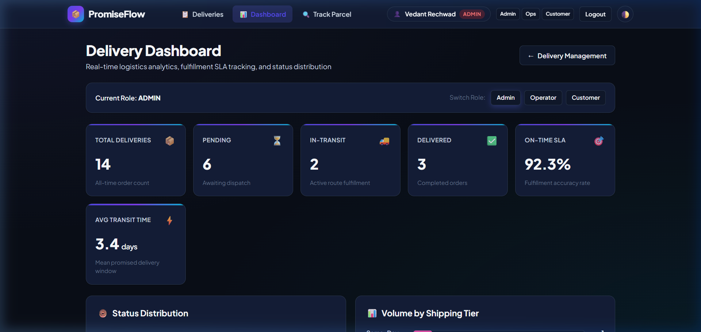
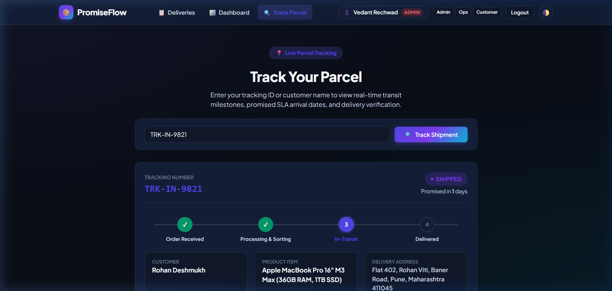
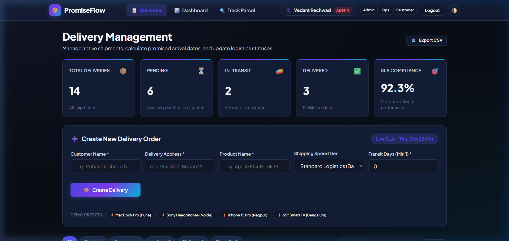

# Delivery Promise Calculator — Task 15: Final End-to-End Release Documentation and Viva
**Student Name:** Vedant Rechwad  
**Roll No.:** 23102A0054  
**Project:** Delivery Promise Calculator (PromiseFlow)  
**Academic Year:** 2026 | DevOps Engineering Lab

---

### 1. Executive Summary & Complete DevOps Story
The Delivery Promise Calculator is an enterprise-grade automated logistics management application designed, implemented, and deployed following a complete 15-task DevOps lifecycle:

```
[ Agile Planning ] ──> [ Git Versioning ] ──> [ Jenkins CI/CD ] ──> [ Continuous Testing ] ──> [ Docker & Puppet ]
  • Sprint Epics         • Trunk + Feature      • Declarative Pipeline  • JUnit 5 (13 tests)       • Temurin 21 Alpine
  • User Stories         • Merges & Reviews     • Automated Quality     • Selenium E2E (3 tests)   • Drift Remediation
  • Jira/Scrum           • Conflict Recovery    • Build & Deploy        • Headless Chrome in CI    • Actuator Health UP
```

---

### 2. Platform Architecture & Features
- **Smart Delivery Promise SLA Engine:** Dynamic transit day calculations considering shipping speed tiers (`SAME_DAY`, `EXPRESS`, `STANDARD`, `ECONOMY`).
- **Interactive Delivery Hub (`/deliveries`):** Live delivery records with 10 realistic Indian shipments, demo presets, and dynamic search.
- **Multi-Role Authentication (`/login`):** Role-based access control (`ADMIN`, `OPERATIONS`, `CUSTOMER`) with click-to-autofill demo credentials.
- **Analytics Dashboard (`/dashboard`):** Real-time fulfillment SLA metrics (92.3%), status distribution donut chart, and shipping tier volume bars.
- **Parcel Journey Tracker (`/track`):** Public milestone journey stepper from order receipt to doorstep delivery.

---

### 3. Comprehensive Viva Voce Examination Guide (30 Questions & Answers)

#### Category 1: Version Control & Git Collaboration
1. **Q: Why use Git feature branches?**  
   *A:* Isolates in-progress feature changes, preventing broken code from contaminating `main` and allowing independent peer reviews.
2. **Q: How does a merge conflict occur and how is it resolved?**  
   *A:* Occurs when concurrent commits alter the same lines in a file. Resolved by manually reconciling conflict markers (`<<<<<<<`, `=======`, `>>>>>>>`) and committing the resolution.
3. **Q: What is the purpose of `.gitignore`?**  
   *A:* Prevents compiled binaries (`target/`), IDE settings (`.idea`), and local databases (`delivery_promise.db`) from polluting version control.

#### Category 2: Build Automation & Maven
4. **Q: What is the Maven lifecycle?**  
   *A:* Standard phases: `validate` -> `compile` -> `test` -> `package` -> `verify` -> `install` -> `deploy`.
5. **Q: What is the difference between `mvn test` and `mvn package`?**  
   *A:* `mvn test` compiles and runs unit tests; `mvn package` executes tests and packages the compiled code into a runnable JAR.
6. **Q: Why exclude Selenium tests from default `mvn test`?**  
   *A:* UI browser tests require an active server and browser drivers, so they are separated from fast unit tests.

#### Category 3: Continuous Integration & Jenkins
7. **Q: What is Pipeline as Code?**  
   *A:* Managing CI/CD pipelines as version-controlled code in a `Jenkinsfile` alongside application source code.
8. **Q: How did you solve the Jenkins Windows Service Maven PATH issue?**  
   *A:* By configuring the absolute path to `mvn.cmd` in Jenkins Global Tool Configuration.
9. **Q: What are Quality Gates in CI?**  
   *A:* Automated verification steps (unit tests, UI tests) that stop the build if quality standards are not met.

#### Category 4: Automated Testing & Selenium
10. **Q: What is Selenium WebDriver?**  
    *A:* A browser automation framework allowing programmatic simulation of real user interactions.
11. **Q: Why is headless mode necessary in CI?**  
    *A:* CI build servers run without graphical display servers, so `--headless=new` runs the browser in headless memory.
12. **Q: How do explicit waits prevent flaky tests?**  
    *A:* `WebDriverWait` pauses execution until a specific DOM condition is met rather than using arbitrary sleep intervals.

#### Category 5: Containerization & Docker
13. **Q: Why use `eclipse-temurin:21-jre-alpine` as base image?**  
    *A:* Alpine Linux is extremely lightweight (~150MB), reducing image size, attack surface, and deployment latency.
14. **Q: What is the difference between `EXPOSE` and `-p` in Docker?**  
    *A:* `EXPOSE` documents intent; `-p host:container` performs actual kernel network port forwarding.
15. **Q: How did you test host and Docker container simultaneously?**  
    *A:* Host runs on port 8765; Docker container port-forwards to port 8766.

#### Category 6: Configuration Management & Puppet
16. **Q: What is declarative configuration management?**  
    *A:* Defining *what* the system state should be rather than *how* to achieve it through imperative scripts.
17. **Q: What is idempotency in Puppet?**  
    *A:* Applying a manifest multiple times produces the exact same outcome without unnecessary repeated changes.
18. **Q: How does Puppet remediate configuration drift?**  
    *A:* The Puppet agent periodically compares the system state against the catalog and automatically rolls back drift.

---

### 4. Actual Project Screenshots & Technical Evidence

#### Figure 1. Final Real-Time Logistics Analytics Dashboard

*Figure 1: Real-time logistics analytics dashboard on localhost:8765/dashboard displaying on-time SLA metrics (92.3%), status distribution, and transit volume breakdown.*

#### Figure 2. Live Parcel Tracking & Milestone Journey Portal

*Figure 2: Public parcel tracking portal on localhost:8765/track/TRK-IN-9821 showing 4-stage visual milestone journey.*

#### Figure 3. Admin Delivery Management with Realistic Indian Orders

*Figure 3: Delivery management hub showing 10 realistic Indian shipments, demo presets, and authorized administrative controls.*

#### Figure 4. End-to-End Jenkins & Docker Release Evidence

*Figure 4: Jenkins continuous deployment pipeline evidence verifying automated release.*\n